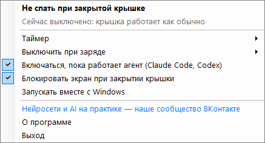

# ClamDown для Windows (неофициальный)

Закрыли крышку ноутбука — а Claude Code, Codex, терминал и загрузки продолжают работать. Маленькая программа в трее, один файл без установщика.

Идея — [ClamDown для macOS](https://github.com/delef/ClamDown) (delef). Это неофициальная версия для Windows, код написан заново на C#.



## Что умеет
- **Переключатель в трее** «Не спать при закрытой крышке». Левый клик по значку — включить или выключить. Зелёная точка на значке — режим включён.
- **Сам включается, пока работает агент** (Claude Code, Codex) и выключается примерно через 5–7 минут после того, как агент закончил. Если выключить вручную или по заряду, пока агент работает, само больше не включится, пока агент не затихнет.
- **Таймер**: 1, 2, 4, 8 часов или без ограничения (для ручного включения).
- **При закрытии крышки** блокирует экран (экран ноутбука гаснет сам).
- **Сам выключается**, когда заряд на батарее упал до порога (по умолчанию 15%), кончился таймер, агент закончил или Windows сообщила о перегреве. Присылает уведомление с причиной, возвращает настройки сна, и ноутбук с закрытой крышкой засыпает.
- **При выключении и перезагрузке Windows** возвращает настройки сна, ноутбук не усыпляет.
- **Страховка.** Если программа упала или её закрыли через диспетчер задач, задача планировщика Windows (работает и от батареи) за 1,5–2,5 минуты вернёт ваши настройки сна. Задачу программа создаёт сама при первом запуске.

## Как это работает
При включении программа запоминает ваши настройки текущей схемы питания: что делать при закрытии крышки и через сколько засыпать и уходить в гибернацию, отдельно для сети и батареи. На время работы ставит «ничего не делать» и «никогда», а при выключении возвращает всё как было. Права администратора не нужны.

## Чего нет, в отличие от версии для Mac
- **Управления вентиляторами.** В Windows нет общего способа, вентиляторами управляют фирменные программы производителя ноутбука.
- **Защиты от перегрева на большинстве ноутбуков.** Без прав администратора Windows обычно не отдаёт температуру. Если отдаёт, программа выключится при 90 °C.

Поэтому **не кладите работающий ноутбук с закрытой крышкой в закрытую сумку**: вентиляторам нужен воздух.

## Установка и удаление
1. Скачайте `ClamDownWin.exe` и положите в постоянную папку, например `%LOCALAPPDATA%\Programs\ClamDown`.
2. Запустите. Значок появится в трее. В меню можно включить «Запускать вместе с Windows».

Удаление: выйти из программы через меню, затем выполнить `ClamDownWin.exe --uninstall` (вернёт настройки сна, уберёт задачу-страховку и автозапуск) и удалить файл и папку `%LOCALAPPDATA%\ClamDownWin`.

Файлы программы: `%LOCALAPPDATA%\ClamDownWin` — настройки, журнал `log.txt`, сохранённые настройки сна на время работы.

## Сборка
Нужна только Windows: `csc` из .NET Framework 4.
```
%WINDIR%\Microsoft.NET\Framework64\v4.0.30319\csc.exe /nologo /target:winexe /optimize+ /out:ClamDownWin.exe /r:System.Management.dll /r:System.Windows.Forms.dll /r:System.Drawing.dll ClamDown.cs
```
Самопроверка (на временной копии схемы питания, ваша не меняется): `ClamDownWin.exe --selftest result.txt`.

---

Сделано в сообществе [«Нейросети и AI на практике»](https://vk.com/neiroseti_ai).

## English
Unofficial Windows take on [ClamDown for macOS](https://github.com/delef/ClamDown). Keeps a laptop awake with the lid closed while you want it or while Claude Code / Codex is working. Saves your power plan's lid action and sleep/hibernate timeouts, sets "do nothing" / "never", and restores them when it stops: battery floor (15% by default), timer, overheating if Windows reports temperature, or 5 minutes after the agent goes idle. A scheduled-task watchdog restores the settings ~90 s after the app disappears. Locks the screen on lid close. No fan control on Windows. No admin rights needed. Do not put a running laptop in a closed bag.
